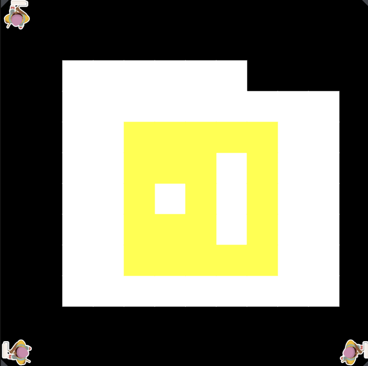

# asphalt-art-project
# Unit 1 - Asphalt Art

## Introduction

Cities use asphalt art to improve public safety, inspire their residents and visitors, and brighten communities. Your goal is to create asphalt art to revitalize The Neighborhood and bring the community together with the help of the Painter.

## Requirements

Use your knowledge of object-oriented programming, algorithms, the problem solving process, and decomposition strategies to create asphalt art:
- **Create a new subclass** – Create at least one new subclass of the PainterPlus class that is used for a component of the asphalt art design.
- **Plan an algorithm** – Use the problem solving process and decomposition strategies to plan an algorithm that incorporates a combination of sequencing, selection, and/or iteration.
- **Write a method** – Write at least one method in a PainterPlus subclass that contributes to a component of the asphalt art design.
- **Document your code** – Use comments to explain the purpose of the methods and code segments.

## Notes: Neighborhood & Painter Class

This project was created on Code.org's JavaLab platform using the built-in Neighborhood GUI output. To test and edit this project you must build in Code.org's JavaLab with the Neighborhood GUI enabled. For reference to the Painter class documentation, [you can read more here.](https://studio.code.org/docs/ide/javalab/classes/Painter)

## Output:

## Reflection

1. Describe your project.

My project consists of 3 extra files that extend my painter plus file to create a digital image of a fried egg with a yolk in it. 

2. What are two things about your project that you are proud of?

I am proud of the way I was able to create this image as a whole since it all started off as a simple sketch on pixel art, and I am proud of the challenges I had to overcome when I faced a few errors. 

3. Describe something you would improve or do differently if you had an opportunity to change something about your project.

If I had the opportunity to change my project I would maybe make the image larger and create a bit more detail to the egg.

4. How is this project related to STEAM (Science, Technology, Engineering, Art, and Mathematics)? Provide explicit examples from the project and details as possible. 

This project is related to STEAM because it triggered the use of critical thinking skills and incorporated aspects of art, technology, engineering, and mathematics. I was able to use creativity in this project by sketching the egg and implementing that into the code to generate the actual icon. I was then able to use engineering and technology when using the actual coding concepts. Lastly, there was small amounts of math in the code as I had to give myself a set number of integers when setting the paint value. 

5. What SLOs did you demonstrate during completing this project?

Some SLOs I demonstrated during the project were using critical thinking in my CTE class and solving those issues/errors in my code to get the final product. 
